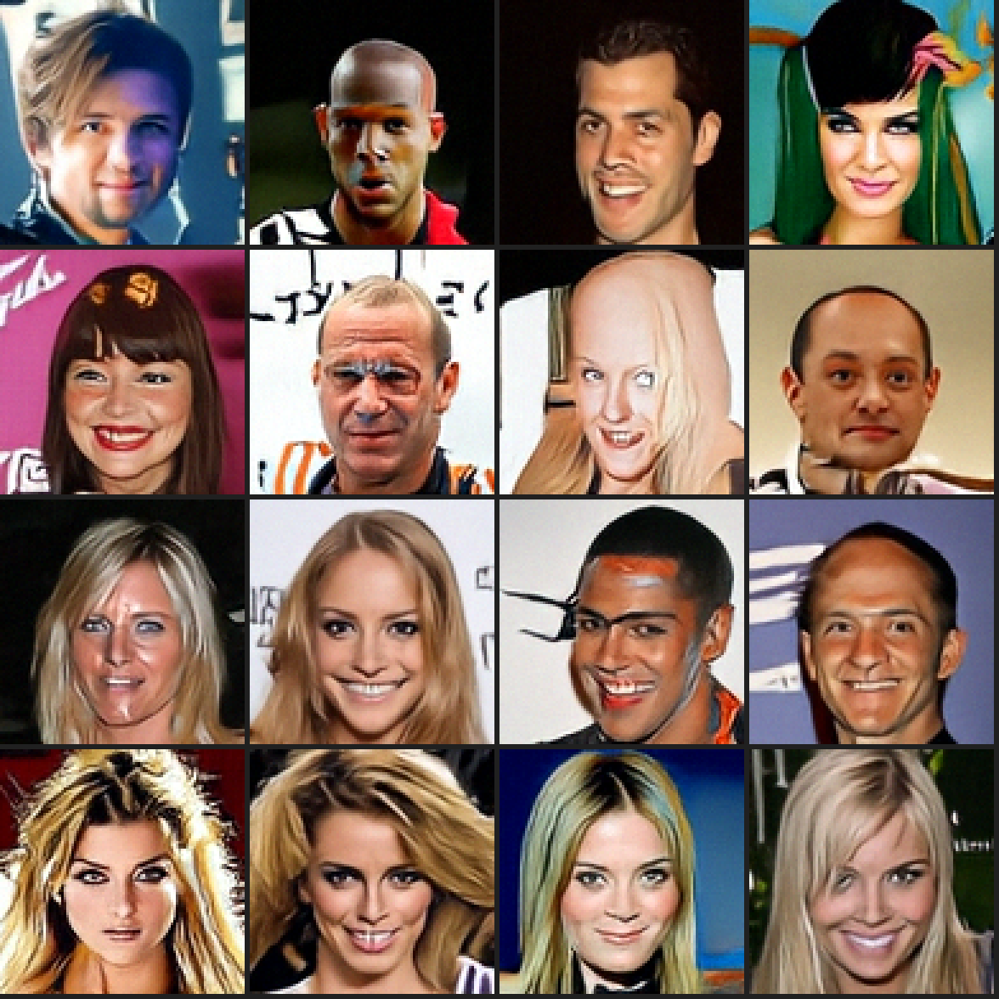

# Diffusion Demo - Pixel JiT 与 DiT 人脸生成

<p align="center">
  
</p>
<p align="center">
  <sub>Pixel JiT · 当前 96×96 主模型 · 20.480M EMA · Heun50 · seed 2027 · 连续生成前 16 张（未筛选）</sub>
</p>

<p align="center">
  
  
  
  
  
</p>

一个面向人脸图像生成的可复现实验项目。当前主线使用 **Pixel JiT** 直接在 48×48 / 96×96 RGB 像素上训练和采样，不经过 VAE/VQVAE；仓库同时保留 VAE/VQVAE + 潜空间 DiT 的完整训练、Web 交互与评估流程。

## Pixel JiT 大 batch 实验

新增 `pixel_experiment.py` / `pixel_ddp_experiment.py`，直接在 RGB 像素上训练，不依赖 VAE、VQVAE 或预训练生成权重。主线从 48×48 起步，再继承全部学习参数扩展到 96×96。结构参考本地 `cstft_jit`、`cstft_jit_arc2face` 的实验经验：patch=4、clean-image prediction、velocity loss、logit-normal 时间采样、EMA、50 步 Heun。当前小模型为 21.89M 参数，384 宽、8 层，输出端带残差卷积头。

### 本轮选用的方案

已完成两轮、8 组主实验及采样消融，结果见 [实验报告](reports/pixel_experiments_2026-10-24.html)。选用 `configs/pixel_ddp_b1024_lr4e4.json`：global batch=1024、lr=4e-4、8,000 步 / 819.2 万张次；主模型在 1×16 GPU 上训练循环耗时 **6.36 分钟**。同结构的弱模型使用 lr=2e-4、2,000 步 / 204.8 万张次，额外约 **1.75 分钟**。这些时间包含训练循环内采样和保存，不含启动、传输、独立评估。

采样使用 EMA、50 步 Heun、autoguidance=2，只在 `t∈[0.1,0.8]` 启用弱模型。调参种子上的 FID 从未引导的 **57.19 降至 43.98**；锁定方案后，独立种子 7777 复核为 **57.52 → 44.27**（KID **0.04832 → 0.03211**）。全程强引导有些配置 FID 更低，但完整网格出现条纹，因此不采用。58.7M 大模型需要约两倍训练时间，引导后的质量也没有超过选中的小模型。

本地已保存主模型、弱模型及可续训完整 checkpoint：`runs/pixel_best/{model_ema.pt,guide_ema.pt,last.pt}`；配置、SHA256、评估与运行记录见 `runs/pixel_best/recipe.json`。RTX 2080 SUPER 实际生成的 64 张样本位于 `runs/pixel_best/sample_seed2027/`，其中 `preview16.png` 展示连续生成的前 16 张，未筛选。原生分辨率是 **48×48**，仍有部分畸形或过平滑样本。

```bash
# 使用本次已训练好的模型；2080 SUPER 用 FP16，其他加速卡可用 BF16。
PYTHONPATH=src python sample_pixel.py \
  --checkpoint runs/pixel_best/model_ema.pt \
  --guide-checkpoint runs/pixel_best/guide_ema.pt \
  --guidance 2 --guidance-start .1 --guidance-end .8 \
  --seed 2027 --count 64 --steps 50 --precision fp16 \
  --output runs/my_faces

# 申请 1×16 GPU 后，从零依次训练弱模型、主模型并评估、采样。
bash scripts/train_pixel_recipe.sh /path/to/celeba_48x48_sprites_v2.npy \
  /path/to/eval_assets /path/to/new_output
```

同看图量的首轮实验表明：batch=4096 时 lr 从 2e-4 提高到 8e-4，FID 从 121.76 降至 82.76；batch=8192、lr=8e-4 为 102.50。大 batch 提高吞吐，但必须一起调整学习率，而且更新次数减少会影响质量。当前数据和模型下，batch=1024 的质量/时间折中更好。

后续尚未验证、值得优先尝试：从当前模型降低学习率续训；比较 EMA 时长；用更小的弱模型降低引导开销；更高分辨率和质量的数据。训练中动态改变 batch 也可做对照，但本轮结果还不能证明它有效。

### 单卡与分布式入口

单卡训练与独立种子采样：

```bash
PYTHONPATH=src python pixel_experiment.py \
  --config configs/pixel_jit_*.json --output runs/pixel_single
PYTHONPATH=src python sample_pixel.py \
  --checkpoint runs/pixel_single/last.pt --output runs/pixel_samples \
  --seed 2027 --count 64 --steps 50 --precision bf16
```

数据使用修复后的 30,000 张缓存，固定划分 29,000 张训练 / 1,000 张验证。`sample_pixel.py` 保存原生 48×48 PNG、原始数组和随机种子；展示图仅放大，不做修复或超分。2080 SUPER 使用 `--precision fp16`。完整 checkpoint 支持续跑，EMA-only checkpoint 用于独立采样。

GPU 集群每个任务申请 `--nodes 1 --gpus-per-node 16 --cpus-per-node 64`，执行：

```bash
bash scripts/run_*_group.sh configs/pixel_ddp_b4096_lr8e4.json \
  /path/to/output /path/to/celeba_48x48_sprites_v2.npy /path/to/eval_assets
```

第一轮比较 `(global_batch, lr)`：`(1024, 2e-4)`、`(4096, 2e-4)`、`(4096, 8e-4)`、`(8192, 8e-4)`。每组看图量 4,096,000；warmup、EMA 和评估间隔均按看图量对齐，避免大 batch 仅因步数不同而获得额外预算。每百万张左右保存固定种子样本和验证损失；输出目录内创建 `STOP` 可在下一日志点保存并停止。续跑要求相同 world size、batch、学习率及数据；可提高配置中的 `max_images` 后用 `--resume /path/to/last.pt`。

`evaluate_pixel.py` 用独立种子生成 1,024 张，与 1,000 张留出图比较 clean Inception FID / KID；这不是 FID50k，不能直接与论文数值比较。Inception 只用于评估。`eval_assets` 包含官方 `inception-2015-12-05.pt` 及 clean-fid 的 Python 包目录 `packages/`。FID 用 float64 对称 PSD 特征分解，处理样本少于 2,048 维特征时的奇异协方差；KID 的子集标准差不代表置信区间。

2026-10-24 最终速度复测（原始记录：`runs/pixel_best/speed_comparison.json`）：

| 相同 FP16 工作负载 | 单张加速卡 | RTX 2080 SUPER | 加速比 |
| --- | ---: | ---: | ---: |
| 21.89M 模型、batch=32 训练 | 904.0 images/s | 347.6 images/s | **2.60×** |
| 16 张、50 步 Heun、未引导采样 | 1.012s | 1.469s | **1.45×** |
| 16 张、50 步 Heun、最终区间引导 | 1.641s | 2.628s | **1.60×** |

均先预热，再取 3 次中位数；训练每次 40 步。早先 5.37× 的训练倍率受到本机另一计算任务占用的影响，现以上表替换。2080 SUPER 仍有游戏/桌面进程，且两端 PyTorch/驱动不同，因此仍是本次实际运行环境的比较。加速卡可用更大 batch；先前单卡 batch=256、BF16 达到 1,764.4 images/s，但不能与上表 FP16 batch=32 当作严格同条件比较。

## 从 48×48 继承权重训练 96×96

保持 patch=4、width=384、depth=8、heads=6，可以 **严格继承全部 21,891,251 个学习参数**：patch 输入卷积、Transformer、时间条件、输出线性层和卷积细化头的形状均不变。96px 的 token 网格从 12×12 增至 24×24；解析 sin/cos 位置编码和 RoPE 不是学习参数，也不在 state-dict 中，按新网格重新生成。

`model.position_scale=1` 使用新网格的原生坐标；`0.5` 将坐标步长缩半，用于比较保留低分辨率空间尺度是否有益。使用源模型 **EMA** 初始化新模型和新 EMA；重置 AdamW、warmup、步数和 EMA 年龄。`--init-from` 与恢复同一训练的 `--resume` 互斥，禁止通过 `strict=False` 静默丢弃不匹配的权重。初始化来源和 SHA256 保存在 `initialization.json` 及 checkpoint 中。

```bash
# 从原始 CelebA ZIP 制作真实 96px 数据，不能用旧 48px cache 放大替代。
python scripts/prepare_celeba96.py \
  --zip '/path/to/celeba/archive (1).zip' --output /path/to/celeba96.npy

# 申请一台 16 GPU 后运行；第一轮配置用于迁移对照。
INIT_CHECKPOINT=/path/to/48px/model_ema.pt \
  bash scripts/run_*_group.sh configs/pixel96_scaled_lr1e4.json \
  /path/to/output96 /path/to/celeba96.npy /path/to/eval_assets

# 独立采样根据 checkpoint 自动选择 96px 尺寸。
PYTHONPATH=src python sample_pixel.py \
  --checkpoint /path/to/output96/last.pt --precision bf16 \
  --seed 2027 --count 64 --output runs/faces96
```

新数据由真实 178×218 CelebA JPEG 中心裁切 178×178、Lanczos 下采样至 96×96；固定抽取官方训练分区 30,000 张及验证分区 1,000 张，原图 ID、裁切和哈希随 cache 保存。旧 48px sprites 缺少原图 ID，因此新验证分区是否参与过旧预训练尚不确定；96px FID 也不能与此前 48px FID 直接比较。

patch=4 时 token 数变为 4 倍、注意力矩阵元素数变为 16 倍，整体耗时由实测决定。若改为 patch=8，可保持 144 tokens，但输入卷积核与输出投影维度都会变化，必须另外转换或重新初始化这两部分，不能直接完整加载旧权重。当前先验证保留 patch=4 的迁移。

加速卡版 PyTorch 曾在多进程构造 96px 位置编码的 CPU `cos/sin` 中触发 SIGSEGV。`build_pixel_model` 仅在 CPU 构造期间使用单线程，随后恢复正常线程数；保留原张量数学计算，训练仍使用全部已分配的加速卡。


首轮 4 组已完成，每组 16 GPU、新增 1.024M 张次（1000 个更新）：

| 初始化 / 位置坐标 | lr | 96px FID ↓ | 训练循环秒 |
| --- | --- | --- | --- |
| 48px EMA / scale=0.5 | 1e-4 | 79.45 | 182.74 |
| 48px EMA / scale=1.0 | 1e-4 | 81.01 | 187.37 |
| 48px EMA / scale=0.5 | 2e-4 | **77.13** | 181.95 |
| 从零 / scale=0.5 | 2e-4 | 167.68 | 181.84 |

这是相同新增 96px 训练预算，继承组还使用了旧 48px 预训练，不是相同总算力比较。位置坐标的较小差异尚无多 seed 证据。原始记录和图见 `runs/` 中对应的首轮实验目录；自包含报告为 `reports/pixel96_transfer_2026-10-24.html`。

### 96px 加速卡性能分析

参考本机加速卡性能分析，已对真实 batch=64、576 tokens、width=384 的完整单卡更新采集系统级性能数据与独立 PyTorch trace；未更换厂商库。三轮交错、无 profiler 计时：默认 AdamW **152.202 ms/step**，fused AdamW **151.741 ms/step**，耗时只下降 **0.30%**。未把这个小收益外推为 DDP 加速。

系统级 profiler 基线捕获 2321 个 kernel。按原始名字分组：逐元素/归约/布局 69.513 ms（46.7%），复制/转换 23.026 ms（15.5%），GEMM 30.059 ms（20.2%），attention 20.530 ms（13.8%）；总 kernel 时间 148.881 ms。RMSNorm 被分解到前两类，不能看独立 norm kernel 的占比。时间线覆盖率不等于硬件利用率。

入口 `scripts/profile_pixel_suite.py`；原始 `.profilerrep`、SQLite、压缩 PyTorch trace 与计时见 `runs/profile96_v1/`。融合复测为 `scripts/profile_pixel_confirm_suite.py`、`runs/profile96_fusion_v2/`；报告为 `reports/pixel96_profile_2026-10-24.html`。

**融合实测完成**：保留厂商 GEMM / Flash Attention，用当前加速卡环境中的 Torch Inductor + Triton 融合 RMSNorm、RoPE、SwiGLU 激活、调制与残差。三个独立进程配对：**152.170 → 88.476 ms/step，吞吐 1.72×**。profiler kernel 数 2321 → 1199。开启 `emulate_precision_casts=True`，参数、梯度和优化器状态保持 FP32。

在同一个 4.096M checkpoint 上恢复模型/优化器/RNG，每组 16 GPU 再训练 1000 步：稳态中位数 **6656 → 11326 张/秒（1.70×）**；包含首次编译、保存和预览的循环时间 **163.28 → 130.71 秒**。FID **70.572 → 70.530**，没有跳过更新。短程质量标准已通过，尚无长程多 seed 等价证明。

初始严格数值门槛的失败记录保留：确定性模式下，融合版本仍有约 1% 的梯度差异、5 步后约 0.024% 的参数差异。独立 FP64 autograd 对照中，6 类算子的前后向均通过预先登记的 BF16 容差（输出相对 L2 <0.6%、梯度 <2%，实际最大约0.37%）。因此该路径需显式启用：`configs/pixel96_scaled_lr2e4_fused.json` 中的 `execution_backend=compile_pointwise`；默认仍为 eager。切换执行后端保留 checkpoint 权重、优化器与 RNG，但运算舍入可能改变。

16 rank 共用共享文件系统的编译缓存曾报 `Stale file handle`，已将缓存放到节点本地 `/tmp/pixel_jit_compile/<run-hash>/rankN/`。首次编译成本计入上面的 DDP 循环时间，稳态吞吐另列。

### 8.192M 阶段的 96px 模型和采样

优胜配置在继承 48px EMA 后累计完成 **8.192M 张次 96px 训练**，原生 96px FID 从首轮 77.13 降至 68.69。使用同一训练过程的 256k 早期 EMA 作弱模型，guidance=3、时间区间 [0.1,0.8]、Heun50：筛选 seed3333 的 FID **60.064**；独立 seed7777 从无引导 **69.303 → 59.407**。这些是 1024 张生成图 / 1000 张验证图的小样本比较。

最终主模型、弱模型、可续训完整 checkpoint 和原生 96px PNG 保存在 `runs/pixel96_best/`。`sample_*_seed2027/preview16.png` 为连续生成的前16张，完整64张和原始数组同时保存，无筛选、超分或人脸修复。最终交付模型来自完整 eager 主训练；融合版本的 16 GPU 对照单独保存在对应实验目录和集群同名目录。

```bash
PYTHONPATH=src python sample_pixel.py \
  --checkpoint runs/pixel96_best/model_ema.pt \
  --guide-checkpoint runs/pixel96_best/guide_ema.pt \
  --guidance 3 --guidance-start 0.1 --guidance-end 0.8 \
  --precision bf16 --steps 50 --seed 2027 --count 64 \
  --output runs/faces96_reproduced
```

2080 SUPER 使用 `--precision fp16`。模型加载默认执行普通 PyTorch 算子，不要求 Triton 或特定加速后端。完整迁移、采样及吞吐结果见 `reports/pixel96_transfer_2026-10-24.html` 与 `reports/pixel96_profile_2026-10-24.html`。

### 96px 继续训练

`configs/pixel96_extend16m_lr2e4.json` 与 `pixel96_extend16m_lr1e4.json` 从同一 8.192M 完整 checkpoint 续训到 16.384M，每组 16 GPU、global batch 1024，启用已经短程验证的 `compile_pointwise`。每新增 2.048M 保存 EMA、完整续训状态、固定噪声验证误差和 64 张预览。

普通 `--resume` 仍严格检查学习率。需要在保留 AdamW 动量、EMA、随机数状态和累计进度的同时调整学习率，必须显式添加 `--allow-resume-lr-change`；组启动脚本对应 `ALLOW_RESUME_LR_CHANGE=1`。变化和父 checkpoint 会写入 `continuation.json` 及完整 checkpoint，不重新 warmup。

```bash
ALLOW_RESUME_LR_CHANGE=1 bash scripts/run_*_group.sh \
  configs/pixel96_extend16m_lr1e4.json /path/to/longer96 \
  /path/to/celeba96.npy /path/to/eval_assets /path/to/8m/last.pt
```

`scripts/evaluate_pixel_continuation.py` 用固定 manifest 比较不可变的中间 EMA，评估任务独立申请一组 16 GPU。相同弱模型、guidance、Heun 步数及噪声 seed 的对照可区分训练收益和采样参数变化。旧 `runs/pixel96_best/` 保留为 8.192M 基线；更长训练的产物使用独立目录。

**充分续训结果**：`2e-4`、`1e-4` 两条路线，以及从 16.384M 的 `1e-4` 分支降到 `5e-5` 的收尾路线，均完成 **24.576M 张次**。末段部分指标回升，最终选用 **20.480M 的 `1e-4` EMA**，而非最后一步。guidance=3、同一 256k guide、区间 [0.1,0.8]、Heun50 均保持不变：选择 seed3333 的 FID **60.064 → 57.133**；确认 seed7777 的 FID **59.407 → 55.563**，未引导 FID **69.303 → 65.275**。这是相同 1,024/1,000 张的小样本比较；确认仅使用另一组噪声，仍是同一验证数据。

新产物在 `runs/pixel96_further/`：`model_ema.pt` 为选中的 **20.480M EMA**；`last.pt` 是该分支 **24.576M 的完整优化器/RNG续训状态**，两者训练步数不同，不能把它当成 20.480M 的精确续训状态。`guide_ema.pt` 与旧方案相同。`recipe.json` 保存选择依据、确认指标、继承关系和文件 SHA256，`sample_*_seed2027/` 保存连续 64 张原生 PNG 和原始数组。对照曲线和全部已测方案见 `reports/pixel96_continuation_2026-10-24.html`。

```bash
PYTHONPATH=src python sample_pixel.py \
  --checkpoint runs/pixel96_further/model_ema.pt \
  --guide-checkpoint runs/pixel96_further/guide_ema.pt \
  --guidance 3 --guidance-start 0.1 --guidance-end 0.8 \
  --steps 50 --seed 2027 --count 64 --precision bf16 \
  --output runs/faces96_further_reproduced
```


## 实验优化与本机 GPU 运行

推荐从可复现的命令行实验入口开始，Web 端也使用同一套 `src/diffusion_demo/core` 训练代码。

2026-10-24 的 RTX 2080 SUPER 实测见 [完整报告](reports/experiment_2026-10-24.html)（含原始指标与图片）。同一数据/种子下，8 轮 VAE 验证 PSNR 18.36 → 19.08 dB，MSE 降低 15.3%；16 张图的 1000 步 DDPM / 50 步 DDIM 分别为 4.14s / 0.193s。不同采样器不保证相同质量，当前生成脸部细节仍模糊。

```bash
pip install -e .
python experiment.py --config configs/local_smoke.json --output runs/my_smoke
python experiment.py --config configs/local_baseline.json --output runs/my_baseline
python experiment.py --config configs/local_recommended.json --output runs/my_experiment
```

`local_smoke.json` 跑通 VAE → DiT → 采样；`local_baseline.json` 与推荐配置的 VAE 使用相同数据、划分和种子，只比较 KL 权重/预热方案。推荐配置适用于实测的 RTX 2080 SUPER 8GB：VAE batch=16、自动选择 FP16，DiT hidden=128/depth=4/patch=1、batch=64、FP32。小模型上混合精度不一定更快，请运行下面的 benchmark 验证。

本机直接 SSH 不通而 tmux 能连时：

```bash
tmux new-session -d -s diffusion-experiment \
  'cd /path/to/diffusion_demo2 && scripts/run_remote_gpu.sh configs/local_recommended.json'
tmux attach -t diffusion-experiment
```

脚本通过 `REMOTE_HOST`、`REMOTE_DIR` 和 `REMOTE_PYTHON` 环境变量配置远端主机、代码目录与解释器，完成后把本次结果复制回本地 `runs/`。不会安装或升级远端共享环境；每次运行新建输出目录，实验入口拒绝覆盖已有目录。

每个实验保存 `environment.json`（含源文件 SHA256）、`config.json` 和 `result.json`；VAE/DiT 各自保存：

- `split.json`：选中图像的数据 SHA256、训练/验证索引。
- `metrics.json`：逐轮训练损失、验证指标和耗时。
- `reconstruction_*.png` / `samples_*.png`：固定验证图片、固定随机种子的可视化。
- `checkpoints/last.pth`：结构、模型、优化器、AMP scaler 及扩散配置；VAE 另保存验证重建最好的 `best.pth`。这些是保存点，当前未提供训练续跑入口。

注意：复制回来的 `result.json` 保留远端原始路径；本地采样时把模型路径改成对应本地 `runs/<run>/...`。

```bash
python scripts/benchmark_dit.py \
  --vae runs/my_experiment/vae/checkpoints/best.pth \
  --dit runs/my_experiment/dit/checkpoints/last.pth \
  --output runs/my_benchmark
python -m unittest discover -s tests -v

# 可选：生成包含曲线、重建图与采样图的独立 HTML 报告
pip install -e '.[report]'
python scripts/report_experiment.py \
  --baseline runs/my_baseline --candidate runs/my_experiment \
  --benchmark runs/my_benchmark --output reports/my_experiment.html
```

本次修复了：BF16 输入与 FP32 权重冲突、TensorBoard 批量图像维度错误、VAE/DiT latent 默认维度冲突、采样忽略训练噪声调度，以及 sprite sheet 每行仅解析 100 列导致漏掉一半图像的问题。新版按实际宽度读取 200 列、30,000 张图，使用 `cache/celeba_48x48_sprites_v2.npy`，旧缓存保留用于追溯。旧 raw state-dict VAE checkpoint 仍可加载；新的 DiT checkpoint 会自动读取结构、schedule、EMA 和 latent 标准化参数。

DiT 默认缓存 **posterior 的均值/方差**，每个 batch 重新采样；标准化统计量只从训练集计算。预览用 50 步 DDIM，不改变训练的 1000 步噪声调度。`sampling_steps=null` 可用完整 DDPM。旧的 DiT GAN 分支没有有效的梯度链路，现显式报错，避免把它误当成有效实验；VAE/VQVAE 的 GAN 分支仍支持。

验证重建 MSE/PSNR 使用 [0,1] 像素范围、VAE posterior mean；DiT 验证噪声固定。降低 KL 的对照关注重建质量，不能单凭训练总 loss 或噪声 MSE 断言生成质量更好。当前是按图片随机划分，并非按人物身份划分。

实现参考：[PyTorch AMP](https://docs.pytorch.org/docs/stable/amp.html)、[SDPA](https://docs.pytorch.org/docs/stable/generated/torch.nn.functional.scaled_dot_product_attention.html)、[DDIM](https://arxiv.org/abs/2010.02502)。

## VAE / VQ-VAE 审计与 JiT 经验迁移

审计报告：[16 GPU 正式对照、权重继承与重建网格](reports/vae_gpu_2026-10-25.html)；[CPU 短程诊断](reports/vae_audit_2026-10-24.html)。修复作用于 `src/diffusion_demo`（Web API、`experiment.py`、`cmdline_train.py`）；根目录 `app.py` / `models` / `training` 是另一套历史实现，未替换其架构。

VQ 默认重建损失改成像素均值，与 codebook/commitment 的均值尺度匹配；`vq_recon_reduction="sum"` 保留旧对照。VAE 的逐图求和 ELBO 不变。真实 48px 人脸小预算对照（896 train / 128 val、同 seed、各 448 次更新）中，旧 grid=4/sum、grid=4/mean、grid=12/sum、grid=12/mean 的最佳验证 PSNR 分别为 **14.04 / 15.20 / 14.52 / 17.96 dB**。这是单 seed、按验证集选择轮次的重建诊断，不代表最终生成质量；原始 split、metrics 和权重位于 `runs/vae_audit_20261024/`。

16 卡复核已完成：四组相同 29,000 train / 1,000 val、global batch=512、lr=2e-4、BF16、32 轮（各 917,504 张看图量）。第 32 轮 PSNR 为 **14.35 / 17.17 / 14.03 / 21.52 dB**，最佳设置相对旧设置的验证 MSE 降低 **80.8%**，各组无跳过更新。仍是单 seed 重建对照，不能替代生成 FID。最佳权重通过对象存储取回并校验，保存在 `runs/vae_gpu_20261025/best_model.pth`；本机 FP32 重算同一验证集为 **21.53 dB**。

原生 96px 对照也已完成：`configs/vq96_{scratch,transfer}_gpu.json` 均使用 24×24 latent、global batch=512、32 轮新增训练（各 950,272 张看图量），第 32 轮 PSNR 为 **从零 23.06 / 继承 48px 权重 25.11 dB**。继承组多用了 48px 预训练，不是相同总预算；旧 sprites 无原图 ID，无法排除新验证图参与旧预训练。最佳 96px 权重位于 `runs/vae_gpu_20261025/best96_model.pth`，已通过 SHA256 和本机严格加载检查；两组均无跳过更新。

主要修复：移除从未参与 forward 的 VAE 参数并兼容旧权重；配置输出分辨率和 latent 网格；VQ 距离查询分块且不建梯度图；记录码本使用率/困惑度；GAN 使用稳定的 logits loss；CLI 使用核心训练器和留出集，停止展示无学习先验的 VQ Gaussian 解码结果。原生 96px 需要真实 uint8 `N,96,96,3` 数据；不会自动放大旧 sprites。

默认两层 hidden 下，VAE 自然网格为 48px→6、96px→12，VQ 为 48px→12、96px→24。只改变网格和输出尺寸时，卷积权重可严格继承；`init_checkpoint` **只初始化模型权重**，新优化器/训练状态从头开始，不是精确续训。源权重的通道数、hidden_dims、codebook size 必须与目标一致。旧 raw state-dict 没有空间尺寸元数据，独立加载仍按历史 48px/4×4；新 checkpoint 保存完整空间配置。

```bash
# 小预算、单进程的 2×2 对照
python scripts/ablate_autoencoder.py --output runs/my_vae_audit

# 48→96 权重初始化；若已有 96px cache 首 1000 张为验证集，保持这个边界。
python cmdline_train.py --model vqvae --epochs 32 --data-limit 31000 \
  --data-path /path/to/celeba96.npy --image-size 96 --latent-spatial-size 24 \
  --split-mode validation_first --val-count 1000 \
  --init-checkpoint /path/to/vq48/checkpoints/best.pth --output-dir runs/my_vq96

# 只在集群已分配的 1×16 GPU 任务内执行；batch_size 是全局 batch。
bash scripts/run_vae_gpu_group.sh configs/vq48_g12_mean_gpu.json \
  /path/to/output /path/to/celeba_48x48_sprites_v2.npy
```

`configs/vq48_g{4,12}_{sum,mean}_gpu.json` 是已在 GPU 运行的四组配置：相同 global batch=512、seed、数据划分、32 轮；29,000 张训练图丢弃不完整全局 batch，每组实际看图量为 917,504 张。DDP 已通过本地双进程测试、16 卡的 VQ48 / VAE96 smoke 和四组正式对照。DDP 每 rank 使用本地 BatchNorm、保存 rank-0 running buffers；分布式 GAN 尚未实现。`images_seen`、`optimizer_updates`、`skipped_updates` 与验证指标写入日志，避免只比较 epoch 或总 loss。

后续优先比较码本初始化/失活码重置、KL 预热与弱 KL、按看图量定义的 EMA。大 batch 要同时对齐预算并调整学习率；BatchNorm、EMA 和码本更新需单独验证。最终仍需训练 latent prior，比较完整网格及 FID/KID；JiT 的融合加速倍率不能直接套用到卷积自编码器。

## 📋 目录

- [特性](#特性)
- [模型架构](#模型架构)
  - [VAE (变分自编码器)](#vae)
  - [VQVAE (向量量化变分自编码器)](#vqvae)
  - [DiT (扩散 Transformer)](#dit-transformer)
  - [DDPM (去噪扩散概率模型)](#ddpm)
- [数学符号速查](#数学符号速查)
- [安装](#安装)
- [使用方法](#使用方法)
- [项目结构](#项目结构)
- [API 文档](#api-文档)

## ✨ 特性

- 🎨 **完整的图像生成流程**: 数据预览 → VAE 训练 → DiT 训练 → 图像采样
- 🌐 **Web 界面**: 基于 Flask 的交互式界面，支持实时训练监控
- 📊 **指标追踪**: 完整的训练指标记录和可视化报告
- 🖼️ **中间结果可视化**: 训练过程中生成图像和重建对比
- 🔄 **Job 系统**: 后台任务管理，支持任务队列和状态追踪
- ⚡ **高效实现**: 支持 BF16 混合精度、CUDA 加速

## 🧠 模型架构

### VAE (变分自编码器)

VAE 通过编码器将图像压缩到潜在空间，再通过解码器重建图像。

#### 网络结构

```
输入图像 (3×48×48)
    ↓
[编码器]
  Conv2d(3→128, 4×4, stride=2)  → 24×24
  ResBlock(128)
  Conv2d(128→256, 4×4, stride=2) → 12×12
  ResBlock(256)
  Conv2d(256→latent_dim, 3×3)    → 4×4
    ↓
潜在变量 z (latent_dim×4×4)
    ↓
[重参数化技巧]
  z = μ + σ·ε,  ε ~ N(0, I)
    ↓
[解码器]
  ConvTranspose2d(latent_dim→256, 4×4, stride=2) → 8×8
  ResBlock(256)
  ConvTranspose2d(256→128, 4×4, stride=2)        → 16×16
  ResBlock(128)
  ConvTranspose2d(128→128, 4×4, stride=2)        → 32×32
  Interpolate(48×48)
  Conv2d(128→3, 3×3)                               → 48×48
    ↓
重建图像 (3×48×48)
```

#### 损失函数

VAE 的损失函数由两部分组成：

$$
\mathcal{L}_{\text{VAE}} = \mathcal{L}_{\text{recon}} + \beta \cdot \mathcal{L}_{\text{KL}}
$$

**重建损失** (MSE):

$$
\mathcal{L}_{\text{recon}} = \frac{1}{N} \sum_{i=1}^{N} \lVert x_i - \hat{x}_i \rVert^2
$$

**KL 散度** (正则化项):

$$
\mathcal{L}_{\text{KL}} = -\frac{1}{2} \sum_{j=1}^{d} \left(1 + \log(\sigma_j^2) - \mu_j^2 - \sigma_j^2\right)
$$

其中：
- $x_i$ 是原始图像
- $\hat{x}_i$ 是重建图像
- $\mu_j, \sigma_j$ 是潜在变量的均值和标准差
- $\beta$ 是 KL 权重系数 (默认 1.0)

### VQVAE (向量量化变分自编码器)

VQVAE 通过离散化的潜在空间学习更有意义的表示。

#### 网络结构

```
输入图像 (3×48×48)
    ↓
[编码器]
  Conv2d(3→128, 4×4, stride=2)   → 24×24
  Conv2d(128→64, 4×4, stride=2)  → 12×12
  Conv2d(64→embedding_dim, 3×3)  → 4×4 (通过 Adaptive Pooling)
    ↓
连续潜在变量 z_e (embedding_dim×4×4)
    ↓
[向量量化层]
  查找最近邻嵌入: z_q = e_k, 其中 k = argmin_j ||z_e - e_j||
    ↓
离散潜在变量 z_q (embedding_dim×4×4)
    ↓
[解码器]
  与 VAE 解码器类似，但输出为量化后的潜在变量
    ↓
重建图像 (3×48×48)
```

#### 损失函数

VQVAE 的损失函数包含三部分：

$$
\mathcal{L}_{\text{VQVAE}} = \mathcal{L}_{\text{recon}} + \beta \cdot \mathcal{L}_{\text{VQ}} + \gamma \cdot \mathcal{L}_{\text{commit}}
$$

**VQ 损失**:

$$
\mathcal{L}_{\text{VQ}} = \lVert z_e - \text{sg}[z_q] \rVert^2
$$

**承诺损失**:

$$
\mathcal{L}_{\text{commit}} = \beta \cdot \lVert \text{sg}[z_e] - z_q \rVert^2
$$

其中：
- $z_e$ 是编码器输出的连续潜在变量
- $z_q$ 是量化后的离散潜在变量
- $\text{sg}[\cdot]$ 是停止梯度操作 (stop-gradient)
- $\beta$ 是承诺成本 (默认 0.25)

### DiT (扩散 Transformer)

DiT 将扩散模型中的 U-Net 替换为 Transformer 架构，在潜在空间进行去噪。

#### 网络结构

```
输入: 带噪潜在变量 x_t (latent_channels×4×4), 时间步 t
    ↓
[Patch Embedding]
  将 4×4 图像划分为 2×2 的 patches → 4 个 patches
  每个 patch 投影到 hidden_size 维度
    ↓
[位置编码] + 可学习的 positional embedding
    ↓
[Transformer Blocks] × depth (默认 6 层)
  - 多头自注意力 (Multi-Head Self-Attention)
  - AdaLN (Adaptive Layer Norm): 根据时间步和类别条件调制
  - FFN (Feed-Forward Network)
    ↓
[输出层]
  LayerNorm + Linear → 预测噪声 ε_θ(x_t, t)
    ↓
输出: 预测的噪声 (latent_channels×4×4)
```

#### AdaLN (自适应层归一化)

每个 Transformer 块使用 AdaLN 进行条件调制：

$$
\text{AdaLN}(x, c) = x \cdot (1 + \gamma(c)) + \beta(c)
$$

其中 $c$ 是时间步和类别条件的嵌入向量，$\gamma$ 和 $\beta$ 是通过 MLP 从 $c$ 学习得到的缩放和偏置参数。

### DDPM (去噪扩散概率模型)

DDPM 定义了前向加噪和反向去噪两个马尔可夫链过程。

#### 前向扩散过程

从原始数据 $x_0$ 逐渐添加高斯噪声，经过 $T$ 步后变成纯噪声：

$$
q(x_t | x_{t-1}) = \mathcal{N}(x_t; \sqrt{1-\beta_t} x_{t-1}, \beta_t I)
$$

利用重参数化技巧，可以直接采样任意时间步 $t$ 的状态：

$$
x_t = \sqrt{\bar{\alpha}_t} x_0 + \sqrt{1-\bar{\alpha}_t} \epsilon, \quad \epsilon \sim \mathcal{N}(0, I)
$$

其中：
- $\alpha_t = 1 - \beta_t$
- $\bar{\alpha}_t = \prod_{s=1}^{t} \alpha_s$
- $\beta_t$ 是噪声调度 (线性或余弦调度)

#### 反向去噪过程

学习一个神经网络 $\epsilon_\theta$ 来预测噪声，从而从 $x_t$ 恢复 $x_{t-1}$：

$$
p_\theta(x_{t-1} | x_t) = \mathcal{N}(x_{t-1}; \mu_\theta(x_t, t), \sigma_t^2 I)
$$

其中均值预测为：

$$
\mu_\theta(x_t, t) = \frac{1}{\sqrt{\alpha_t}} \left( x_t - \frac{\beta_t}{\sqrt{1-\bar{\alpha}_t}} \epsilon_\theta(x_t, t) \right)
$$

#### 训练目标

简化后的训练目标是预测添加到 $x_0$ 的噪声：

$$
\mathcal{L}_{\text{DDPM}} = \mathbb{E}_{x_0, t, \epsilon \sim \mathcal{N}(0,I)} \left[ \lVert \epsilon - \epsilon_\theta(x_t, t) \rVert^2 \right]
$$

#### 采样算法

```
从标准正态分布采样 x_T ~ N(0, I)
对于 t = T, T-1, ..., 1:
    z ~ N(0, I) if t > 1, else z = 0
    ε_θ = model(x_t, t)  # 预测噪声
    x_{t-1} = (x_t - β_t·ε_θ/√(1-ᾱ_t)) / √α_t + σ_t·z
返回 x_0
```

## 📐 数学符号速查

| 符号 | 含义 |
|------|------|
| $x_0$ | 原始图像 |
| $x_t$ | 时间步 $t$ 的带噪图像 |
| $z, z_e, z_q$ | 潜在变量 (连续/量化前/量化后) |
| $\mu, \sigma$ | 潜在变量的均值和标准差 |
| $\epsilon, \epsilon_\theta$ | 真实噪声和模型预测的噪声 |
| $\beta_t$ | 时间步 $t$ 的噪声方差 |
| $\alpha_t = 1 - \beta_t$ | 保留率 |
| $\bar{\alpha}_t = \prod_{s=1}^t \alpha_s$ | 累积保留率 |
| $T$ | 总扩散时间步 (通常 1000) |
| $d$ | 潜在空间维度 |
| $N$ | 批量大小 |

## 🚀 安装

### 环境要求

- Python >= 3.9
- PyTorch >= 2.3
- CUDA (可选，但推荐用于训练)

### 安装步骤

```bash
# 克隆项目
git clone <repository-url>
cd diffusion_demo2

# 安装依赖
pip install -r requirements.txt

# 或者安装为可编辑包
pip install -e .
```

### 依赖列表

```
flask>=2.0.0
torch>=2.3.0
torchvision>=0.18.0
pillow>=9.0.0
numpy>=1.21.0
requests>=2.25.0
tqdm>=4.60.0
tensorboard>=2.10.0
einops>=0.6.0
```

## 🎯 使用方法

### Web 界面 (推荐)

启动 Web 服务器：

```bash
python -m diffusion_demo.server
```

访问 http://127.0.0.1:5000，你将看到：

1. **Dataset 标签**: 下载和预览 CelebA 48×48 数据集
2. **Train VAE/VQVAE 标签**: 训练变分自编码器
3. **Train DiT 标签**: 训练扩散 Transformer
4. **Sample 标签**: 使用训练好的模型生成图像
5. **Jobs 标签**: 查看训练任务历史和日志

### 命令行训练

进行快速 VAE 训练并生成可视化报告：

```bash
python cmdline_train.py \
    --model vae \
    --epochs 30 \
    --batch-size 64 \
    --data-limit 30000 \
    --lr 0.001
```

参数说明：
- `--model`: 模型类型 (`vae` 或 `vqvae`)
- `--epochs`: 训练轮数
- `--batch-size`: 批量大小
- `--data-limit`: 使用数据量 (最大 30000)
- `--lr`: 学习率
- `--bf16`: 启用 BF16 混合精度

训练完成后会生成：
- `runs/cmdline_<timestamp>/final_model.pth`: 训练好的模型
- `runs/cmdline_<timestamp>/report.html`: 包含图表和生成图像的可视化报告

### 环境变量

| 变量 | 默认值 | 说明 |
|------|--------|------|
| `PORT` | 5000 | Web 服务器端口 |
| `HOST` | 127.0.0.1 | 服务器主机 |
| `DEVICE` | auto | 计算设备 (auto/cuda/cpu) |
| `DATA_LIMIT_DEFAULT` | 2048 | 默认数据限制 |

## 📁 项目结构

```
diffusion_demo2/
├── CLAUDE.md                   # 原始 SPEC 文档
├── README.md                   # 本文件
├── requirements.txt            # Python 依赖
├── pyproject.toml              # 包配置
├── cmdline_train.py            # 命令行训练脚本
│
├── src/diffusion_demo/         # 主包
│   ├── server.py               # Flask 服务器入口
│   ├── api.py                  # REST API 路由
│   ├── jobs.py                 # 任务管理系统
│   │
│   ├── core/                   # 核心功能
│   │   ├── data_loader.py      # CelebA 数据加载
│   │   ├── models/             # 模型定义
│   │   │   ├── vae.py          # VAE/VQVAE/判别器
│   │   │   └── dit.py          # DiT 模型
│   │   └── training/           # 训练逻辑
│   │       ├── train_vae.py    # VAE 训练
│   │       └── train_dit.py    # DiT 训练和采样
│   │
│   ├── ui/                     # Web 界面
│   │   ├── templates/
│   │   │   └── index.html      # 主页面
│   │   └── static/
│   │       ├── style.css       # 样式
│   │       └── app.js          # 前端逻辑
│   │
│   └── utils/                  # 工具函数
│       ├── io.py               # I/O 操作
│       └── torch_env.py        # PyTorch 环境
│
├── cache/                      # 数据集缓存
├── checkpoints/                # 模型检查点
├── runs/                       # TensorBoard 日志
├── results/                    # 生成样本
└── var/jobs/                   # 任务元数据
```

## 🔌 API 文档

### 系统信息

```http
GET /api/system
```

返回 PyTorch 版本、CUDA 可用性、数据集缓存状态等信息。

### 数据集操作

```http
POST /api/dataset/ensure          # 下载并缓存数据集
GET  /api/dataset/samples?count=16&seed=0  # 获取随机样本
```

### 任务管理

```http
GET  /api/jobs?type=vae&limit=50  # 列出任务
GET  /api/jobs/<job_id>           # 获取任务详情
GET  /api/jobs/<job_id>/log?offset=0  # 获取任务日志
POST /api/jobs/<job_id>/cancel    # 取消任务
```

### 训练接口

```http
POST /api/jobs/vae    # 启动 VAE/VQVAE 训练
POST /api/jobs/dit    # 启动 DiT 训练
POST /api/jobs/sample # 启动图像采样
```

### 检查点管理

```http
GET /api/checkpoints  # 列出可用检查点
```

## 🎓 参考文献

1. **VAE**: Kingma, D. P., & Welling, M. (2013). Auto-Encoding Variational Bayes. *arXiv preprint arXiv:1312.6114*.

2. **VQVAE**: van den Oord, A., et al. (2017). Neural Discrete Representation Learning. *NeurIPS*.

3. **DDPM**: Ho, J., Jain, A., & Abbeel, P. (2020). Denoising Diffusion Probabilistic Models. *NeurIPS*.

4. **DiT**: Peebles, W., & Xie, S. (2023). Scalable Diffusion Models with Transformers. *ICCV*.

## 📄 License

MIT License

---

<p align="center">
  用 ❤️ 和 PyTorch 构建
</p>

### VQ 码本 EMA 与 latent DiT（2026-10-25）

`train_vae_model` 现在支持 `codebook_decay`、`codebook_data_init`、
`dead_code_threshold` 和 `model_ema_halflife_images`。默认值保留梯度更新码本；
开启码本 EMA 后，计数与向量和在所有训练 rank 上求和，只在成功的 optimizer
step 后更新。死码阈值按均匀使用量的比例定义，评估和采样不修改码本。
模型权重 EMA 平滑 encoder/decoder，复制码本和 BN buffers；每轮分别验证 raw/EMA，
按固定验证集重建 MSE 选择 `best.pth`。从旧码本 checkpoint 切换到 EMA
是显式初始化，`init_checkpoint` 不恢复 optimizer。

`latent_ddp_experiment.py` 冻结选定 VQ-VAE，缓存离散码，使用训练集统计量归一化，
训练 clean-latent prediction / velocity loss 的 DiT。支持同一 world size 下
`--resume .../last.pt`，恢复 optimizer、模型 EMA 和各 rank RNG。
完整状态保存在 `last.pt`，采样权重为 `ema_<images>.pt`，旁边的
`autoencoder.pth` 必须一起保留。每组实验在集群预留 1 节点 × 16 GPU 后运行：

```bash
bash scripts/run_latent_gpu_group.sh \
  --config configs/latent_vq48_old.json --output /path/to/new-run
# 首次运行前设置 autoencoder/data；续训时保持它们一致，只延长 images 预算：
bash scripts/run_latent_gpu_group.sh \
  --config /path/to/config.json --output /path/to/run --resume /path/to/run/last.pt
```

生成评估使用 `--mode eval --checkpoint .../ema_<images>.pt --weights-dir ...`；
`--requantize` 比较末端重新量化，`--guide` / `--guidance` 比较弱模型引导。
生成的 `real_features.npy` / `fake_features.npy` 可由
`scripts/score_pixel_features.py` 计算同口径 FID/KID。
实际结果及连续样本见 `reports/vq_latent_2026-10-25.html`；
运行 `python scripts/report_vq_latent.py` 可从已下载的实验记录重建报告。

无需 Inception 即可独立采样：

```bash
PYTHONPATH=src:. python sample_latent.py --checkpoint /path/to/ema_8388608.pt \
  --output /path/to/samples --seed 2027 --count 64 --steps 50
```

该命令同时保存原生 48px 单图、连续网格和包含模型 SHA256 的元数据。

### VQ 感知损失与 GAN 对照

安装 `.[perceptual]` 后，用官方 ImageNet SqueezeNet 与 LPIPS v0.1 权重建立离线资产：

```bash
python scripts/prepare_perceptual_weights.py --output /path/to/lpips_squeeze_v01.pth
```

`vq_perceptual_experiment.py` 专门测试 **冻结 encoder / quantizer、微调 decoder**：
使用已有的离散码缓存，并严格核验数据与 latent 映射；支持 MSE、LPIPS、延迟启用的
hinge PatchGAN、decoder EMA。判别器使用 GroupNorm，生成器阶段不更新判别器参数。
每组在集群分配一个完整的 16 GPU 组后运行：

```bash
bash scripts/run_vq_perceptual_gpu.sh \
  --config configs/vq48_decoder_lpips.json --output /path/to/new-decoder-run
```

配置中的 `autoencoder`、`data`、`codes`、`perceptual_weights` 需要指向实际资产。
`steps × batch_size` 是追加训练图像数。MSE 按验证 MSE、感知组按验证 LPIPS 保存
`best.pth`；是否改善生成仍须用固定采样协议的 FID/KID 与图像核验。

完整 VQ-VAE 联合训练也支持 `perceptual_weights`、`perceptual_loss_weight` 和
`selection_metric`，见 `configs/vq48_joint_lpips.json`。联合训练改变了 latent 映射，
需要重新缓存、训练对应的 DiT。该路径仍使用全局同步码本 EMA 和独立模型 EMA。

生成评估/采样可显式传 `--autoencoder /path/to/decoder/best.pth`，仅允许 encoder
与量化器全部张量和原 prior 一致的 decoder 替换。续训额外核验 latent 归一化
center/scale；更换 latent 映射会报错，避免将不兼容的 prior 与 VQ-VAE 拼在一起。
报告生成器为 `scripts/report_vq_perceptual.py`，产物在
`runs/vq_perceptual_20261025/` 与 `reports/vq_perceptual_2026-10-25.html`。

`latent_ddp_experiment.py` 另支持可选的 `pca_components`：仅用训练集离散码的
频率估计 FP64 加权协方差，投影后按主成分标准差归一化；采样时恢复到原始
64 维再解码。模型保存完整 basis、offset 和 scale，续训核验投影一致。
该操作保留原 VQ-VAE，实际保留方差写入 `projection.json`；是否改善生成质量
仍须实验判断。`configs/latent_vq48_pca8_patch1.json` 为 8 维、patch 1 对照。

### 视觉模型 best-of-N

Pixel JiT 的随机性来自起始高斯噪声；当前 Heun 积分中不额外加噪。固定模型、seed
及采样设置可基本复现，换 seed 生成不同候选。当前是无条件模型，候选不保证是同一个人。

下面生成 64×8 张候选，用兼容视觉 API 的模型逐张评分，每组取一张。
API 凭据只在本机从 `.env` 的 `LLM_API_KEY` 读取，不打印、不上传至集群：

```bash
PYTHONPATH=src:. .venv/bin/python sample_pixel_best_of_n.py \
  --checkpoint runs/pixel96_further/model_ema.pt \
  --guide-checkpoint runs/pixel96_further/guide_ema.pt --guidance 3 \
  --count 64 --best-of-n 8 --seed 2027 --steps 50 \
  --output runs/faces96_bestof8
```

2080 SUPER 加 `--precision fp16`。采样已完成时可单独运行评分器；也可用于
`sample_latent.py` 输出的原生 PNG。失败后用相同参数续跑，会按图片和评分提示词的
哈希复用已完成响应；输出目录拒绝混入另一组候选或评分规则。

```bash
.venv/bin/python scripts/rank_face_candidates.py \
  --input runs/faces96_bestof8/candidates/images \
  --output runs/faces96_bestof8/ranking \
  --group-size 8 --ns 1,2,4,8 --concurrency 4
```

评分侧重五官结构、自然程度、细节与伪影，不评价颜值、身份或人口属性。
所有候选、原始响应、token 用量、分项分数、SHA256 和入选 ID 均保存；同分取较早候选。
`selection.json` 记录每组 N=1/2/4/8 的结果。**同一评分器筛选后的均分上涨并非独立
质量证明，筛选后的分布和多样性也可能变化，不能沿用未筛选 FID。**

2026-10-25 已完成 64 张原生 96px 候选的真实视觉模型评分试跑，8 组 N=1/2/4/8
平均分为 48.25 / 50.75 / 51.50 / 53.75。示例与完整记录在
`runs/pixel96_bestofn_20261025/pilot64/`；报告入口 `scripts/report_best_of_n.py`。

`scripts/sample_pixel_pool.py` 在已分配的单节点上用 torchrun 分摊候选，每张采用
`base_seed + candidate_id`，保存准确种子和 PNG 哈希。四组集群对照分别为
50步/g3、50步/g2、100步/g3、50步/g3但引导区间改为[0.2,0.8]；每组512候选、
完整16 GPU，噪声种子对齐。后处理只等待已提交任务，通过对象存储取回 PNG，再评分并更新
`reports/pixel96_bestofn_2026-10-25.html`；不提交新任务、不修改其他实验，也不传输密钥。


### 96px EMA 再优化：batch × learning rate（2026-10-25）

新 4×16 GPU 集群上启动四组训练（59170–59173），每组独占一个 16 GPU 节点：global batch 1024/2048 × learning rate 5e-5/1e-4。全部从已选定的 20.480M EMA 初始化，重新建立 AdamW；这不是从同一步优化器状态恢复。每组新增 8.192M 张次，每 1.024M 保存验证指标、样图与 EMA，继续使用已验证的 compile_pointwise。四组采用相同图像预算、warmup 和按图像数缩放的 EMA，便于比较大 batch 与学习率的影响。配置为 `configs/pixel96_refine_*.json`，运行记录在 `runs/pixel96_refine_20261025/`。结果尚未完成，当前最佳权重仍保留原版本。

上一轮四组 best-of-N 候选采样（56217–56220）已在旧 1×16 集群完成，保留其产物并由本机视觉模型评分流水线继续处理；未在新集群重复提交。

新增的 4×16 集群实验仍按每组 `num_nodes=1,gpus_per_node=16` 提交，
配置为 `configs/latent_{pca8_16m,joint16m,base32m,pca8_b2048_16m}.json`。
续训保持 global batch 512，以保存的 optimizer、EMA、per-rank RNG 接续；
batch 2048 方案从零训练，避免把 checkpoint 的 step 错当成不同 batch 下的已训练图像数。
资源队列与完成后评估由 `runs/vq_perceptual_20261025/parallel_monitor.py` 记录。

`latent_eval_suite.py --manifest FILE` 应用普通 Python 在已预留的 16 GPU 任务中运行，
先清除集群继承的 `WORLD_SIZE/RANK/LOCAL_RANK`。每个条目启动独立 torchrun，
使用 `--standalone` 自动分配 rendezvous 端口；不在同一个 GPU worker 中反复重建通信组。

已完成轮次的独立采样确认（seed7777，1024 fake / 1000 real）：
MSE decoder + latent DiT 16,777,216 images + interval guidance2 的 FID 为 **57.937**，
此前 latent 为 64.986，pixel JiT 为 44.267；因此已有改善，但尚未超过 pixel JiT。
权重在 `runs/vq_perceptual_20261025/release/`，本机重新生成的 64 张原生图像在
`runs/vq_perceptual_20261025/sample_cpu_seed2027/images/`。

```bash
PYTHONPATH=src:. python sample_latent.py \
  --checkpoint runs/vq_perceptual_20261025/release/model_ema.pt \
  --guide runs/vq_perceptual_20261025/release/guide_ema.pt --guidance 2 \
  --device cpu --precision fp32 --seed 2027 --count 64 --output samples/vq16m
```


### 96px 再优化的首轮结果与噪声分布实验

四组均已完成新增 8.192M 训练；`b2048_lr1e4` 最初在训练后的 Inception 评估中出现 GPU driver invalid argument，训练完整保存，独立评估重跑已完成。统一 seed3333、Heun50、guide 区间 [0.1,0.8] 的未筛选 FID：

| 模型 | guidance2 | guidance3 |
| --- | ---: | ---: |
| 原20.480M EMA | 57.719 | 57.133 |
| b1024 lr5e-5 | 56.879 | 56.132 |
| b1024 lr1e-4 | 57.267 | 56.306 |
| b2048 lr5e-5 | 57.474 | 56.840 |
| b2048 lr1e-4 | 57.617 | 57.044 |

这是 1024 fake /1000 real、同一验证集的小样本选择结果；未引导 FID 没有改善，原最佳权重继续保留。固定种子样图、全量候选和评分见 `reports/pixel96_refinement_review_20261025.html`。原模型采样变体的视觉模型 best-of-8 均分为 g2/Heun50 56.84、g3/Heun50 53.88、g3/Heun100 53.81、g3/较短引导区间54.41；筛选后评分上涨不能当作独立质量证明。

以 b1024/lr5e-5 的完整 8.192M checkpoint 为共同起点，任务59185–59188继续到16.384M：原学习率对照、lr2e-5、logit-time均值-0.4（偏低噪声）、-1.2（偏高噪声）。标准差均0.8，验证时间分布保持原来的(-0.8,0.8)。分布变更必须显式设置 `ALLOW_RESUME_TIME_CHANGE=1` / `--allow-resume-time-change`，续训记录包含旧/新分布。改变训练分布后的 train loss 不可直接与对照比较。新配置在 `configs/pixel96_noise_*.json`，四组继续各占16 GPU。


本轮四组新模型各512张候选的视觉模型评分已全部完成、无错误。g2/Heun50 的 best-of-8 均分：b1024lr5e-5 **57.06**，b1024lr1e-4 **57.63**，b2048lr5e-5 **58.25**，b2048lr1e-4 **56.69**；旧模型 **56.84**。各模型全512候选均分仍约49.3–49.5，不能据此宣称整体质量大幅提升。除 FID 最佳分支外，best-of-N 最佳的 b2048lr5e-5 也已提交完整状态续训任务 **59190**，配置 `configs/pixel96_noise_continue_b2048_lr5e5.json`，等待空闲16 GPU节点。原始96px图、配对对比、全部评分与训练继承信息见 `reports/pixel96_refinement_review_20261025.html`；简要样图是 `reports/pixel96_best_pick_comparison_20261025.png`。

四组并行实验的专门对比页由 `python scripts/report_vq_parallel.py` 生成：
`reports/vq_parallel_comparison_2026-10-25.html`，同时导出连续前 16 张的对比 PNG。
评估统一使用 GPU/BF16、seed3333、Heun50、guidance2；CPU 补充采样有明确标注，
因随机数后端不同，不把 CPU 和 GPU 的同编号图像当作逐张对应。

PCA8/batch2048 候选的本机采样复现：

```bash
PYTHONPATH=src:. python sample_latent.py \
  --checkpoint runs/vq_perceptual_20261025/comparison_models/pca8_b2048_16m/model_ema.pt \
  --autoencoder runs/vq_perceptual_20261025/release/autoencoder.pth \
  --guide runs/vq_perceptual_20261025/comparison_models/pca8_b2048_16m/guide_ema.pt \
  --guidance 2 --seed 3333 --device cpu --precision fp32 --count 64 \
  --output samples/pca8_b2048
```

已准备的单组续训记录在 `runs/vq_perceptual_20261025/followup_selection.json` 和
`followup_status.json`（评估齐全、提交成功后生成）。选择四组同口径 FID 最优者，
保持 batch，从完整 checkpoint 恢复 optimizer/EMA/RNG，学习率减半，追加
16,777,216 张训练图像。此阶段不加 GAN；结束后自动评估 seed3333、seed7777。


**当前实验方向（2026-10-25）：已暂停 best-of-N 和视觉模型评分。** 已完成图片、分数和报告保留；仅因 best-of-N 排名追加的续训任务59190已取消。资源继续用于未筛选采样/FID、学习率续训与噪声时间分布变体，不再主动启动候选筛选或评分。状态见 `runs/best_of_n_paused_20261025.json`。

96×96 latent DiT 迁移入口为 `configs/latent_vq96_pca8_transfer.json`：
从已验证的 PCA8/batch2048 48px EMA 权重开始，VQVAE 原生网格 12→24、输出 48→96；
编码器和码本权重保持逐张量相同，先按 `configs/vq96_decoder_transfer.json` 微调 MSE 解码器。
DiT 的 patch1 网格从 144 tokens 扩至 576 tokens，仅对 learned position embedding 做
bicubic 插值；保留预训练的 PCA basis、offset、center 和 scale，不用新码频率重新拟合轴。
`--init-checkpoint` 使用 EMA 权重 warm start，重置 optimizer 和 96px 图像计数；
`--resume` 仍用于同一模型、同一坐标系、同一 world size 的完整状态续训，两者互斥。
新增 `snapshot_images` 可保存早期弱引导检查点，同时维持较稀疏的后续保存频率。

原生 96px 使用已有 31,000 张缓存，前 1,000 张验证、其余 30,000 张训练。
新分区原图 ID 不相交；旧 48px sprites 无原图 ID，无法排除验证图参与旧预训练。
48px 和 96px 的 FID 不直接比较。96px 首轮新增训练预算 8,388,608 张，global batch2048、
lr1e-4、1×16 GPU，不启用 GAN。训练前验证 16 GPU 的实际 forward/backward；完成后
分别评估无引导与早期 96px 检查点引导，并保留 seed7777 的独立采样结果。
任务及样本记录：`runs/vq96_transfer_20261025/`。

96px 并行变体（每组仍为 1×16 GPU）：
`configs/latent_vq96_b2048_lr5e5.json`、`latent_vq96_b2048_lr2e4.json`、
`latent_vq96_b4096_lr2e4.json`。三组均从同一份 48px/32M EMA 开始，
各新增 4,194,304 张；与主线在同图像预算下比较 raw / guided FID，
大 batch 先完成 16 GPU 两步实测。除了 batch 和学习率，模型、码本、
PCA 坐标、数据、EMA 半衰期及采样设置保持一致。结果与启动记录在
`runs/vq96_variants_20261025/`，连续样本和指标见
`reports/vq96_variants_2026-10-25.html`。当前不加 GAN。

普通 VAE 的 PCA 诊断（2026-10-25）见 `reports/vae_pca_2026-10-25.html`。
`vae_pca_probe.py` 冻结早期 16 通道/4×4 网格、1792 张训练图/8 轮的 KL=0.1 与 KL=1 模型，
只在原训练 ID 上拟合通道 PCA；用原验证集和另外 1000 张未参与训练的图片评估。
同时比较 mu 与采样 latent，后者的拟合协方差使用 Cov(mu)+E[diag(exp(logvar))]，
各截断共享相同每图后验噪声。集群任务 59205（1×16 GPU）成功，指标、图片及投影已取回并校验哈希。
KL=0.1 模型的均值路径 16→12 通道损失约 0.03 dB，16→8 的 LPIPS 退化更明显。
这是既有 latent 冗余诊断，不是 PCA 增加模型表达能力的证据；这些早期 VAE 的重建本身仍很模糊。
若从头训练连续 VAE，应优先比较直接训练窄 latent 的重建与生成效果；后续窄通道对照与 latent DiT 结果见下文。

直接训练普通 VAE 窄通道对照：`configs/vae96_narrow_c8.json`、`c12`、`c16`。
同为原生96px、12×12 latent网格、hidden_dims=[64,128]、beta=0.01、8轮KL预热、
batch512、lr2e-4、EMA半衰期8192张，128轮（3,801,088次看图），各1×16 GPU。
本实验不使用PCA，所有组从零训练；先实际两步smoke。`vae_reconstruction_eval.py`
对最佳/最后权重分别评估后验均值与固定噪声样本的重建PSNR/LPIPS。
集群任务59211/59212/59213；记录与自动回收文件在`runs/vae_narrow96_20261025/`，
可视报告为`reports/vae_narrow96_2026-10-25.html`。这是重建对照；随后选择16通道最佳VAE接入下述latent DiT。

16通道普通VAE接latent DiT：`configs/latent_vae96_c16.json`，集群任务 59219。
冻结`vae_narrow96_20261025/c16`最佳VAE，原生96px、12×12×16 latent，不用PCA；
`continuous_latents.py`缓存后验mu/logvar，每步重新抽样。通道归一化只用训练部分，
方差为Var(mu)+E[exp(logvar)]。`latent_ddp_experiment.py`保留VQ路径并支持连续VAE；
完整续训保持posterior_mode、数据、batch及每rank RNG，禁止对连续VAE重新量化。
DiT从零训练，width384/depth8/heads6/patch1、batch2048、lr4e-4，目标16M张，
先做16 GPU 两步实测，在8M/16M评估raw/guided及最终独立采样种子。
10项相关测试通过，包含连续后验采样下的精确续训。记录和自动回收结果在
`runs/vae_latent96_20261025/`，报告为`reports/vae_latent96_2026-10-25.html`。

任务59219已完成16,777,216张训练：8M无引导FID77.557，16M无引导FID69.824。
原来的52万张弱模型引导强度2会导致过曝，16M FID93.240，不建议用于这条连续VAE路线。
任务59225/59226已完成：16M主模型配4M弱模型、强度2的FID57.065；
4M弱模型强度1.5为61.817，8M弱模型强度2为62.602；无引导独立seed7777为71.119。
当前选择4M弱模型、强度2；这些是1024样本筛选结果，完整样本见同一报告。
对照VQVAE96的16M引导FID72.023/71.630；两条路线预训练历史不同。
仓库同期pixel96报告约53.65，当前连续VAE结果尚未超过它。
最后8M阶段吞吐42.7k张/秒；144 latent tokens相对旧VQVAE的576更省计算，
这是配方级速度对照，不是单卡硬件加速比。
最终EMA与冻结VAE已取回，逐张量核对VAE与所选best完全一致；校验记录见
`runs/vae_latent96_20261025/local_integrity.json`。VAE原始checkpoint和精简导出文件
字节哈希不同，模型配置及所有权重张量完全相同。

官方完整训练集扩容（连续VAE路线）：已核对全部162,770个官方训练ID，新增132,770张。
原1,000张验证图和30,000张训练图的ID、顺序、像素逐字节保留；不使用官方测试集。
数据审计在`runs/vae_full96_20261025/data_audit.json`。
完整训练集与30k训练集作等量对照；每组1×16 GPU。
两组从相同16,777,216张完整状态续训至33,554,432张，冻结VAE和latent坐标系，
batch2048、lr4e-4不变；最终比较raw和4M弱模型guidance2的两组固定噪声seed。
`--allow-data-expansion`显式允许验证过的数据扩展，保留optimizer/EMA/RNG/归一化；
它是改变采样分布的续训，不声称与旧数据训练轨迹精确一致。默认resume仍拒绝换数据。
数据文件SHA改成流式计算，避免每个rank一次性分配4.5GB读取缓存。13项相关测试通过。

任务59232/59233均已成功完成33,554,432张累计曝光。完整集raw FID62.323，
4M弱模型g2为51.064/52.730（均值51.897）；30k等量对照raw63.259，
g2为51.483/52.204（均值51.844）。两组当前基本持平，不能宣称扩数据改善FID；
比旧16M阶段57.065的提升主要可由续训解释。两组新增16.78M曝光各约389/396秒。
最终模型、冻结VAE、弱模型均已取回并校验；原始样本网格、数据审计、运行记录见
`reports/vae_full96_2026-10-25.html`，主线采样配方见`runs/vae_full96_20261025/selected.json`。
此轮扩展DiT训练数据，VAE保持原30k训练版本不变。完整集作为后续主线保留，
当前选择不代表其在两种子FID上显著优于30k对照。

### 实验报告展示约定

后续实验报告统一先展示按指标排序的总结表，再展示实验细节与完整样本。

- 总结表包含排名、方法与关键训练差异、主要指标、各采样种子指标/次数、辅助指标、训练吞吐和固定样例。
- 同一评估协议内，生成实验默认按跨种子平均 FID 升序，KID 用于辅助比较/同分排序；重建实验明确主指标及升降方向。不同分辨率、验证集或指标实现分开排名，不混排。
- 保留每个种子的分数与实际评估次数；不能把单种子当作多种子均值验证，也不能把微小数值排名宣称为显著改进。
- 样例固定使用同一采样 seed 的前若干张（当前为 seed3333 的前4张），提供连续64张原图链接，不挑选、不增强。总体排名和后续单次评估/完整样本网格均按所标明的指标排序。
- 未完成评估、失败或没有指标的实验单列状态，不赋予质量排名。实验主线选择与数值第一名分开标注。

`scripts/report_vae_full96.py` 已实现以上形式：自动发现同一轮的新实验组和采样方法、计算均值、排序并关联固定样本。
